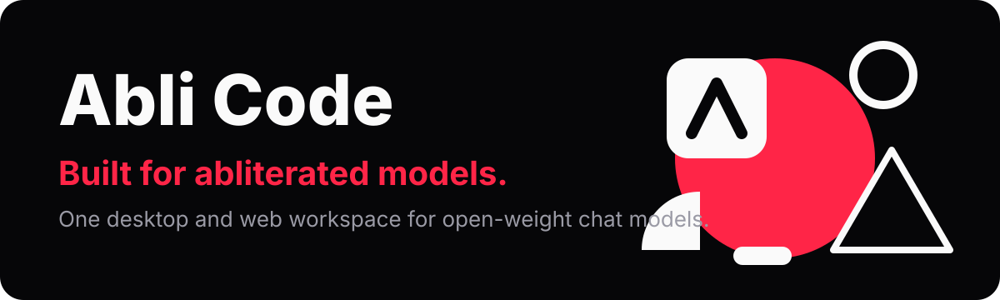
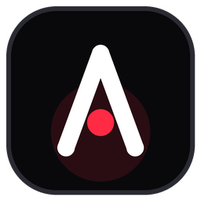

<p align="center">
  
</p>

<p align="center">
  <a href="https://github.com/umaralfatehsuhaimi02-rgb/abli-code/releases/latest"></a>
  
  
</p>

<p align="center">
  
</p>

<h3 align="center">A chat workspace built for abliterated models.<br>Desktop and web, one account, one app.</h3>

---

## Download

Grab the latest build from the [Releases page](https://github.com/umaralfatehsuhaimi02-rgb/abli-code/releases/latest).

| Platform | Installer (wizard) | Portable zip |
|---|---|---|
| Windows 64-bit (x64) | `Abli-Code-Setup-1.0.0-x64.exe` | `Abli-Code-1.0.0-win-x64.zip` |
| Windows 32-bit (x86) | `Abli-Code-Setup-1.0.0-ia32.exe` | `Abli-Code-1.0.0-win-ia32.zip` |
| Windows on ARM (arm64) | `Abli-Code-Setup-1.0.0-arm64.exe` | `Abli-Code-1.0.0-win-arm64.zip` |

`Abli-Code-Setup-1.0.0.exe` is a single installer that picks x64 or ARM64 for you.


## What you get

- **Abliterated models in one place.** Switch models mid-thread from a single picker.
- **Desktop and web.** Same account, same threads, same look.
- **Abli Mini.** Abliterated 1.58-bit models that run on your own PC, with a built-in check for what your device can handle.
- **MCP in one paste.** Drop in a standard `mcpServers` JSON block and the servers are added.
- **A real workspace.** Projects, recents, pinned and archived threads, rename, duplicate, export to Markdown.
- **Chat that works the way you expect.** Copy, edit and resend, regenerate, stop, markdown with copyable code blocks, photo and file attachments.
- **Sign in anywhere.** Google, GitHub, or email with a 6-digit code. On desktop, sign-in opens your default browser.
- **Pay in the app.** Stripe checkout inside the app, switch or cancel plans any time, top up credits.

## Models

| Model | Tier | Good for |
|---|---|---|
| Lite Mini | Free | Quick, light chat |
| Lite Chat | Free | Everyday chat |
| Abli Flash 3 | Cheap | Fast and small |
| Abli Flash 5 | Cheap | Fast, abliterated |
| Abli Flash 5.1 | Cheap | Faster and smarter than Flash 5 |
| Abli Coder 5 | Cheap | Coding |
| Abli Coder 5.1 | Premium | Stronger coding |
| Abli Coder 5.2 | Premium | Best at coding |
| Muse Spark Open | Premium | General use with image input |

Anything starting with **Abli** is abliterated. Within a family, a higher number is a smarter model. Flash is for speed, Coder is for code.

Muse Spark Open: Built with Muse Spark Open.

## Abli Mini

Run abliterated 1.58-bit ternary models (Bonsai 2, PTQ1_0) on your own computer. Private, free, and offline once installed. Open **Abli Mini** in the desktop app and it checks your processor, memory, graphics card and disk, then tells you which models your PC can run.

| Model | Size | Download | Good for |
|---|---|---|---|
| Abli Mini Lite | 2B | about 0.45 GB | Tiny and instant, quick chat |
| Abli Mini Flash | 4B | about 0.95 GB | Fast and capable, everyday chat |
| Abli Mini Coder | 9B | about 2.0 GB | Writing and fixing code |
| Abli Mini Coder 2 | 27B | about 5.7 GB | The smartest local model, hard problems |

Coder 2 is a fully abliterated build. Lite, Flash and Coder use a tiny abliteration adapter on top of the ternary base, so they are research-grade: they answer without refusing, and the 9B gives up a few points of general accuracy for it.

The engine and models download once, with a progress bar, and stay on your PC. Nothing you type in Abli Mini leaves it. Needs the desktop app on Windows. Speeds depend on your hardware.

## Plans

| Plan | Price |
|---|---|
| Free | $0, with a shared daily token pool for free models |
| Plus | $20 / month |
| Pro | $50 / month |
| Max | $100 / month, bigger free pool, Flash 5 and 5.1 included in it |

You can also top up credits (minimum $5).

## Run it yourself

```bash
git clone https://github.com/umaralfatehsuhaimi02-rgb/abli-code.git
cd abli-code
npm install
cp .env.example .env     # then fill in your keys
npm run launch           # builds the web app and serves it on http://127.0.0.1:4747
npm run desktop          # opens the Electron app
```

| Script | What it does |
|---|---|
| `npm run dev:web` | Vite dev server |
| `npm run build` | Build the web bundle |
| `npm start` | Start the backend |
| `npm run launch` | Build, then start |
| `npm run desktop` | Run the Electron app |
| `npm run dist` | Build Windows installers and zips |
| `npm test` | Run the tests |

### Configuration

All keys live in `.env` on the server and nowhere else. See `.env.example` for every name. The main ones:

```
SUPABASE_URL=
SUPABASE_PUBLISHABLE_KEY=
STRIPE_SECRET_KEY=
STRIPE_PUBLISHABLE_KEY=
BREVO_API_KEY=
EMAIL_FROM=
<PROVIDER>_API_KEY=
```

The desktop app never contains provider keys. For production, host the server and set `desktop/backend.json` so the app talks to it. See [DEPLOY.md](DEPLOY.md). Profit maths is in [PROFIT.md](PROFIT.md).

## Building installers

`npm run dist` builds the Windows NSIS setup wizard and zips. The x86 build needs an older Electron because Electron 45 has no 32-bit Windows build:

```bash
npx electron-builder --win nsis zip --ia32 -c.electronVersion=43.8.12
```


## License

MIT. Muse Spark Open is used under Meta's Muse Model License.